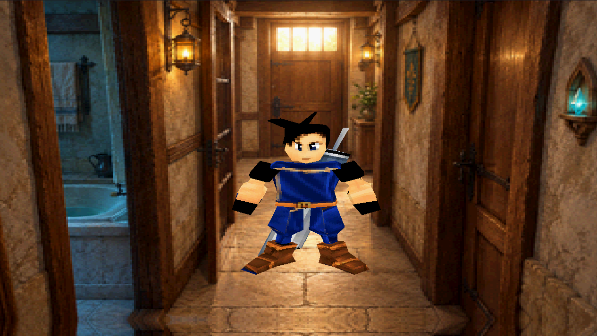
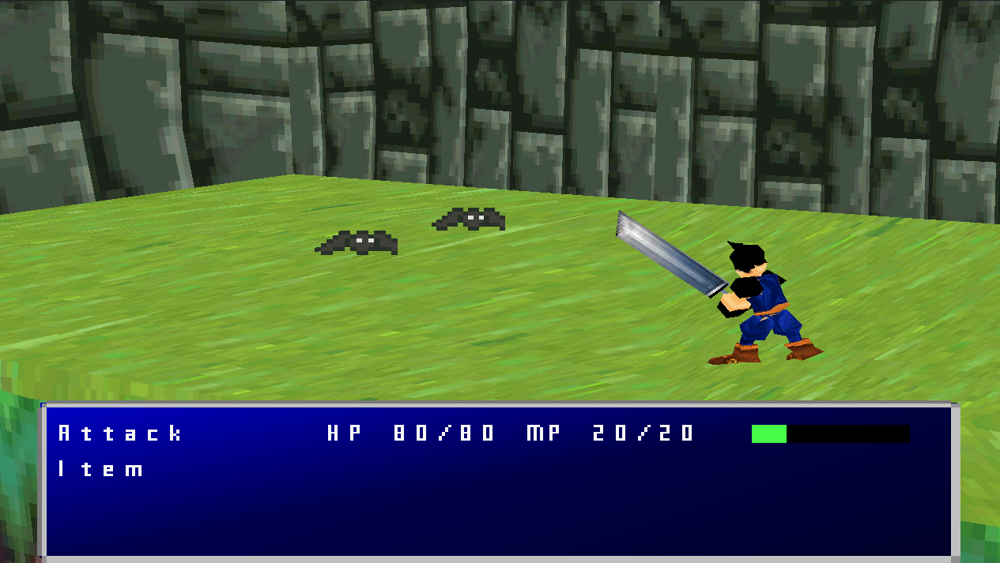
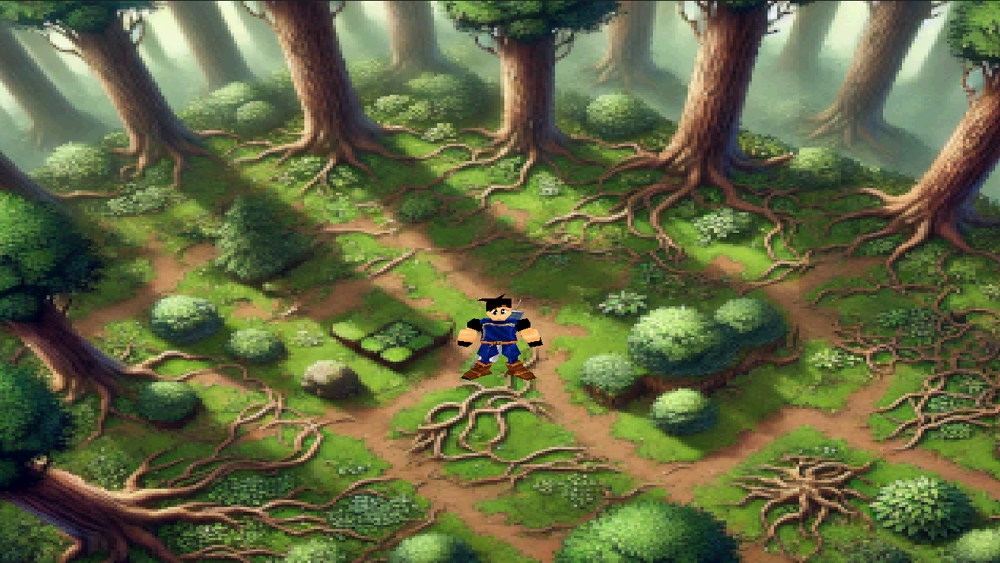

# PlayStation 1 3D graphics demo

This project was proudly written by hand from 2019 to 2026. I am now continuing its development with a coding agent.

The executable now starts as a small **demo disc** with two selectable games:

- **Crystal Fantasy**: the original RPG demo, unchanged.
- **Neon Ranger**: a 2.5D side-scrolling shooter with 2D sprite actors, 3D platforms,
  jumping, shooting, enemies and a camera-orbiting special move.

### Features

- Render 3D
- Gamepad input
- XA File music player
- Sound effects
- OBJ parser / 3d models
- Texture mapping
- Camera 3D
- Sprites
- Pre-rendered backgrounds
- Read data from CD-ROM

### Dependencies
- Psy-Q SDK

## Config
  1. Download Psy-Q from psxdev.net, make a "temp" and "psyq" folder under C:\ 
  2. Copy the folders "include", "lib" and "bin" from the sdk to C:\psyq\
  3. Execute PSPATH.BAT (this file is in the psyq folder) if you are on Windows 9x,  
     instead if you are on Windows NT (Windows 2000, XP),  
     you need to add the paths and variables inside PSPATH.BAT to the environment variables settings.
  4. Download `data.zip` from the latest release, extract it, and place the extracted folder in the  
     project directory (alongside `src` and `cdrom`).

## Build stages.bin
  stages.bin is a binary file that contains all the pre-rendered background data.  
  You need to generate it using a program I created.  
  The purpose of this is to define all the data you need, and it will create the stages.bin file.  
  This file will be included in the ISO and will be read to load all the necessary background data.  
  You must have GCC and Make installed to be able to run the compilation command:
  ```console
  cd path/of/project/stages
  make build
  ```

## Compile on Windows (9x/2000/XP) and make game.iso file with buildcd.exe
  (this method is suggested for the release build to play on real hardware)
  1. edit cdrom/CONF.CTI file by changing the root variable to the correct path where your project is located
  ```console
  Define root C:\path\of\project
  ```
  2. move inside src folder with the command line (cmd on windows) and launch the following command
  ```console
  psymake
  ```

## Compile on DosBox and make game.iso file with buildcd.exe
  (good enough for developing)
  1. Install dosbox in your system
  2. launch the following command from the project's root 
  ```console
  dosbox -conf dos.conf
  ```

## Burn CD-ROM and Add License
 To burn a CD-ROM to play on a real PS1, first patch the ISO with DiscPatcher.exe. The program can be found inside the CDROM folder.  
 Select the PSX console and Europe region, then burn the ISO with ImgBurn or any CD burner that supports DAO (Disc-at-Once).


## Follow me on [YouTube](https://www.youtube.com/@FabioPallini88) 






