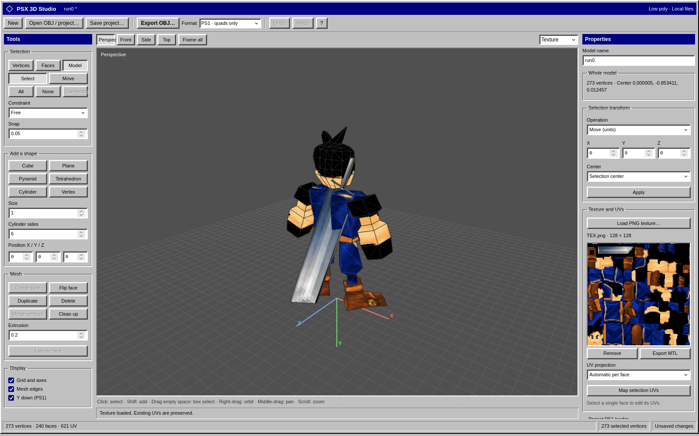

# PSX Studio

Minimal PS1 tools with a Windows 95/98 interface.

- **Stage editor:** native GTK 4, C11 and OpenGL app for backgrounds, walkable platforms and transitions. Run `make -C psxstudio/stage_editor build`, then `make -C psxstudio/stage_editor run` from the repository root. Dependencies: GTK 4.12+, JSON-GLib, Epoxy, a C compiler and pkg-config. Save JSON manually; imports stay in `stage_editor/assets/` until you export their PNG/TIM package. Tests: `make -C psxstudio/stage_editor test`.
- **3D model editor:** open [index.html](3dmodel_editor/index.html) directly in your browser; no server required. Edit low-poly meshes and UVs, save `.model.json` projects, and export PS1-compatible OBJ files. One pose and one PNG texture at a time.

Project-local skill: [psx-studio](skills/psx-studio/SKILL.md). Ask your assistant to read it before creating stages or 3D models.

**Stage editor**

**3D model editor**

