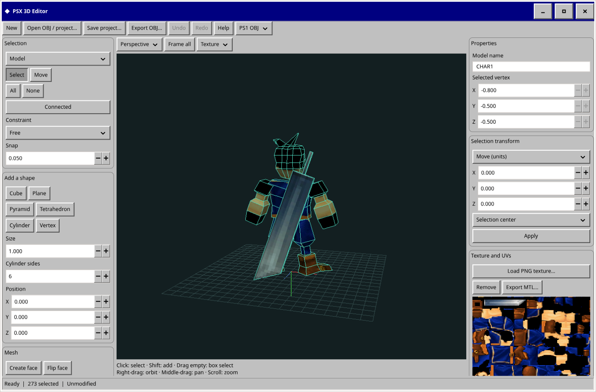

# RPG Editor

Minimal PS1 tools with a Windows 95/98 interface.

- **Stage editor:** native GTK 4, C11 and OpenGL app for backgrounds, walkable platforms and transitions. Run `make -C rpg-editor/stage_editor build`, then `make -C rpg-editor/stage_editor run` from the repository root. Dependencies: GTK 4.12+, JSON-GLib, Epoxy, a C compiler and pkg-config. Save JSON manually; imports stay in `stage_editor/assets/` until you export their PNG/TIM package. Tests: `make -C rpg-editor/stage_editor test`.
- **3D editor:** native GTK 4, C11 and OpenGL app. Run `make -C rpg-editor/3d_editor build`, then `make -C rpg-editor/3d_editor run`. Uses the same dependencies as the stage editor. Edit vertices, faces and UVs; add primitives; transform, extrude, merge and undo; save `.model.json` projects and export PS1 or standard OBJ. Imports triangle/quad OBJ files (triangulate larger polygons first). One pose and one PNG texture; no rig, timeline or TIM conversion. Tests: `make -C rpg-editor/3d_editor test`.

Project-local skill: [rpg-editor](skills/rpg-editor/SKILL.md). Ask your assistant to read it before creating stages or 3D models.

**Stage editor**

**3D editor**

