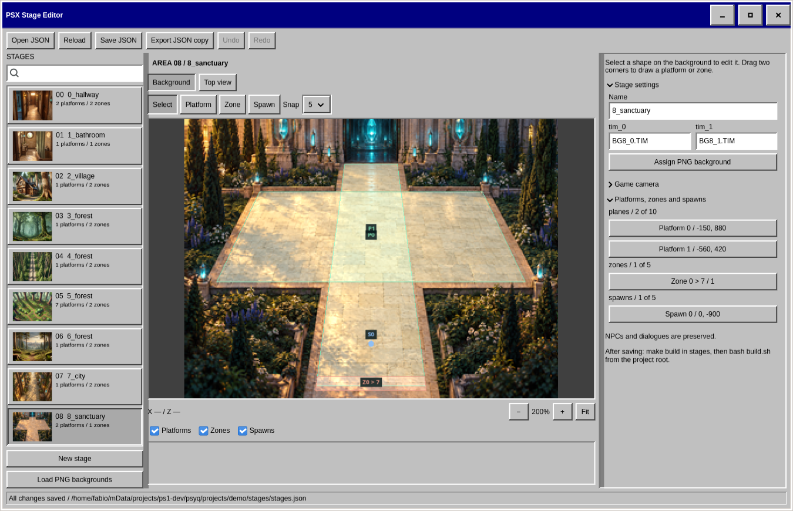

# Stage Editor

Native GTK 4, C11 and OpenGL app for PS1 backgrounds, walkable platforms and transitions, with a Windows 95/98 interface.

From the repository root:

```bash
make -C stage_editor build
make -C stage_editor run
```

Dependencies: GTK 4.12+, JSON-GLib, Epoxy, a C compiler and pkg-config.
Save JSON manually; imports stay in `stage_editor/assets/` until you export their PNG/TIM package.

Run core tests with `make -C stage_editor test` and preview tests with
`python3 -m unittest discover -s stage_editor/tests`.

Project-local skill: [stage-editor](skills/stage-editor/SKILL.md). Read it before creating stages.


